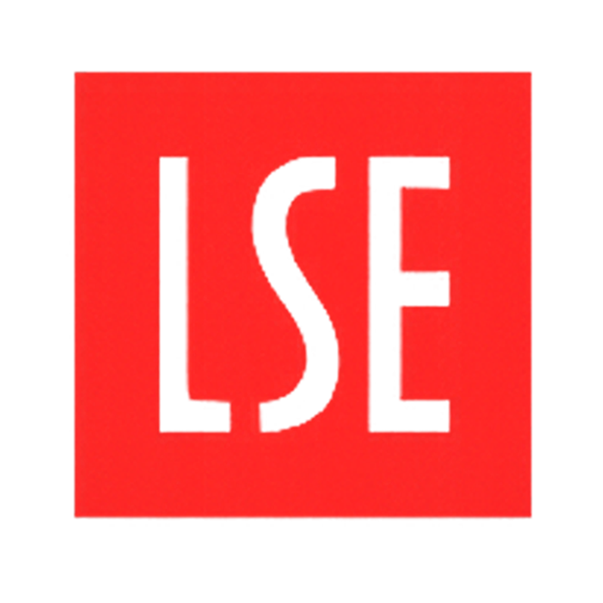

# 🌐 MACROGLIDE Globe

[English](#english) · [Українська](#українська)

**[▶ Live demo](https://fotinia-sadovskaya.github.io/macroglide-globe/)** · Status: prototype

[](./screenshots/globe.png)

---

## English

An interactive 3D globe in the browser that shows the world's major stock exchanges. Each exchange is a marker on the globe; click it to open a card with the exchange's logo, a short description and prices.

**Frontend playground** built with [Vite](https://vitejs.dev/) and [react-three-fiber](https://github.com/pmndrs/react-three-fiber) for 3D in the browser.

**Goal:** to visualise global macroeconomic data in an interactive format.

> **Status: prototype.** The prices shown in the cards are demo (sample) data, not live market quotes.

### Features (implemented)

- [x] Interactive 3D Earth with a texture map
- [x] Stock exchange markers (magenta dots) placed by geographic coordinates
- [x] Info card with logo, description and prices (demo data)
- [x] Camera controls: rotate, lock the view, zoom in and out

### Tech stack (currently used)

- React 19
- react-three-fiber and drei
- Three.js (WebGL)
- Vite
- TypeScript
- ESLint
- gh-pages (deployment)

### Roadmap (planned improvements, not yet implemented)

- [ ] Live market data via an API (Axios or the Fetch API)
- [ ] Charts for economic indicators (D3.js or Chart.js)
- [ ] Search for countries and regions
- [ ] Centering the globe on a region (for example, Asia)
- [ ] Saving favourite countries
- [ ] Export data to CSV
- [ ] Animated transitions between scenes
- [ ] Dark theme
- [ ] Styling with TailwindCSS or Styled Components
- [ ] Optional: CesiumJS for a geospatial globe

### Run locally

```bash
git clone https://github.com/fotinia-sadovskaya/macroglide-globe.git
cd macroglide-globe
npm install
npm run dev
```

### Scripts

| Command | Description |
| --- | --- |
| `npm run dev` | Start the development server |
| `npm run build` | Build the project into `dist/` |
| `npm run preview` | Preview the production build locally |
| `npm run lint` | Check the code with ESLint |
| `npm run tsc` | Run the TypeScript compiler |
| `npm run deploy` | Publish `dist/` to the `gh-pages` branch |

### Deployment

The site is published with `gh-pages`: run `npm run build`, then `npm run deploy`. In the repository, **Settings → Pages** uses the **Deploy from a branch → gh-pages** source.

### Exchanges on the globe

Binance, Coinbase, NYSE, NASDAQ, London Stock Exchange (LSE), Tokyo Stock Exchange, Hong Kong Stock Exchange, Shanghai Stock Exchange, Euronext, TSX (Toronto), BSE India, ASX (Australia).

### Project structure

```plaintext
macroglide-globe/
├── public/                  # Static files served as-is
│   ├── logos/               # Exchange logos (PNG)
│   ├── models/              # 3D models (GLB, GLTF)
│   ├── earth_texture.jpeg   # Globe texture
│   └── favicon.png
├── screenshots/             # Screenshots for the README and social previews
├── src/
│   ├── assets/              # Local media (textures, icons, 3D)
│   ├── components/          # UI components and the 3D scene
│   │   ├── ExchangeMode.jsx # Exchange display mode switcher
│   │   ├── ExchangeDot.jsx  # Exchange markers on the globe
│   │   ├── ExchangeObj.tsx  # Alternative exchange representation (3D object)
│   │   └── GlobeScene.jsx   # Main scene: globe, markers, light, camera
│   ├── data/                # Static data and types
│   │   ├── Types/Exchange.ts
│   │   └── exchanges.ts     # Exchanges with coordinates and metadata
│   ├── utils/utils.js       # Coordinate conversion and data helpers
│   ├── App.jsx, App.css
│   ├── index.css
│   └── main.jsx             # React entry point
├── index.html               # Vite HTML template
├── package.json
├── tsconfig.json
├── vite.config.js
├── eslint.config.js
├── LICENSE
└── README.md
```

### License and credits

MIT. Free to use with attribution.

This project uses [NASA Earth Textures](https://blenderartists.org/t/8k-earth-texture-download-free/1193918) and other public resources: [James Hastings-Trew](https://planetpixelemporium.com/earth.html), licensed under [CC BY 4.0](https://blenderartists.org/t/8k-earth-texture-download-free/1193918).

---

## Українська

# 🌐 Macroglide Globe

Інтерактивна 3D-візуалізація глобуса з позначенням ключових фондових бірж світу. Кожна біржа представлена з логотипом, коротким описом та актуальними торговими даними.

**Frontend playground** побудований на [Vite](https://vitejs.dev/) та [react-three-fiber](https://github.com/pmndrs/react-three-fiber) — для 3D-візуалізацій у браузері.

**Мета:** Візуалізація глобальних макроекономічних показників у інтерактивному форматі

---

## 🚀🛠️ Технології

- [x] `Three.js` або `CesiumJS` — для 3D-глобуса
- [x] `Vite`
- [x] `React` / `Vue` — для UI
- [x] `TypeScript` (опціонально)
- [x] `TailwindCSS` / `Styled Components`
- [ ] `Axios` / `Fetch API` — для отримання біржових даних
- [ ] `D3.js` або `Chart.js` (для графіків)
- [ ] `GeoJSON` — для географічного розташування точок

---

## 📦 Встановлення

```bash
git clone https://github.com/your-username/macroglide-globe.git
cd macroglide-globe
npm install
npm run dev
```

---

## 📁 Структура

```plaintext
macroglide-globe/
├── public/                          # Статичні файли, доступні напряму з браузера
│   ├── logos/                       # Логотипи бірж (PNG)
│   │   └── logo.png
│   ├── models/                      # 3D-моделі для Three.js (GLB, GLTF)
│   │   └── earth.glb
│   ├── earth_texture.jpeg          # Текстура глобуса
│   └── favicon.png                 # Іконка сайту (відображається у вкладці браузера)
│
├── screenshots/                    # Прев’ю або знімки екрану для README / соцмереж
│   └── globe.png
│
├── src/                            # Вихідний код додатку
│   ├── assets/                     # Локальні медіа-файли (текстури, іконки, 3D)
│   │   ├── earth.usdz              # Альтернативна модель Землі (для AR)
│   │   ├── earthmap4k.jpg          # Високоякісна текстура Землі
│   │   └── react.svg               # Логотип React
│
│   ├── components/                 # UI-компоненти та логіка сцени
│   │   ├── ExchangeMode.jsx        # Компонент перемикання режимів бірж
│   │   ├── ExchangeDot.jsx         # Візуалізація точок бірж на глобусі
│   │   ├── ExchangeObj.tsx         # Альтернативне представлення біржі (через об'єкт)
│   │   └── GlobeScene.jsx          # Основна сцена: глобус, точки, світло, камера
│
│   ├── data/                       # Статичні дані та типи
│   │   ├── Types/                  # Типи TypeScript для бірж
│   │   │   └── Exchange.ts
│   │   └── exchanges.ts            # Масив бірж з координатами та метаданими
│
│   ├── utils/                      # Допоміжні функції
│   │   └── utils.js                # Конвертація координат, обробка даних
│
│   ├── App.css                     # Глобальні стилі або Tailwind-конфігурація
│   ├── App.jsx                     # Головний компонент додатку
│   ├── index.css                   # Базові стилі для index.html
│   └── main.jsx                    # Точка входу в React-додаток
│
├── .gitattributes                  # Налаштування Git для кодування, diff тощо
├── .gitignore                      # Ігноровані файли (наприклад, node_modules, .env)
├── eslint.config.js                # Конфігурація ESLint для перевірки коду
├── index.html                      # HTML-шаблон для Vite
├── LICENSE                         # Ліцензія проєкту
├── package-lock.json               # Автоматично згенерований файл залежностей
├── package.json                    # Список залежностей, скрипти, мета-дані проєкту
├── README.md                       # Документація: опис, інструкції, посилання
├── tsconfig.json                   # Налаштування TypeScript
└── vite.config.js                  # Конфігурація Vite: білд, базовий шлях, плагіни
```

---

## 🧠 Функціонал

- 🌍 Інтерактивна карта світу
- 🔍 Пошук країн та регіонів
- 📍 Відображення бірж на глобусі (магентові точки)
- 🏢 Інформаційні поп-апи з логотипом, описом та цінами
- 📊 Відображення економічних даних у вигляді графіків (опціонально)
- 📁 Експорт даних у CSV
- 🧩 Центрування на регіон (наприклад, Азія)
- 🔄 Оновлення даних у реальному часі (опціонально)

---

## 📌 TODO

- [x] Анімації переходів між сценами
- [x] Інтеграція з API для динамічних даних
- [x] Збереження обраних країн
- [x] Темна тема

---

## 📑 Ліцензія та авторські права

MIT — вільне використання з зазначенням авторства.

Цей проєкт використовує [NASA Earth Textures](https://blenderartists.org/t/8k-earth-texture-download-free/1193918) та інші публічні ресурси - [James Hastings-Trew](https://planetpixelemporium.com/earth.html) згідно з ліцензією [CC BY 4.0](https://blenderartists.org/t/8k-earth-texture-download-free/1193918).

---

## 🌍 Світові біржі

| Біржа           | Логотип                                   | Країна           |
|-----------------|--------------------------------------------|------------------|
| Binance         |    | 🌐 Глобальна     |
| Coinbase        |   | 🇺🇸 США          |
| NYSE            |       | 🇺🇸 США          |
| NASDAQ          |     | 🇺🇸 США          |
| LSE             |        | 🇬🇧 Велика Британія |
| Tokyo SE        |      | 🇯🇵 Японія       |
| Hong Kong SE    |   | 🇭🇰 Гонконг       |
| Shanghai SE     |   | 🇨🇳 Китай         |
| Euronext        |   | 🇪🇺 Європа        |
| TSX             |        | 🇨🇦 Канада        |
| BSE India       |        | 🇮🇳 Індія         |
| ASX             |        | 🇦🇺 Австралія     |
---

### 🇨🇳 Приклад: Shanghai Stock Exchange

> **Shanghai SE** — найбільша біржа материкового Китаю, що відіграє ключову роль у розвитку економіки країни.

**Торгові дані:**

- 🔹 Остання ціна: `27420`
- 🟢 Купівля: `27370`
- 🔴 Продаж: `27420`

## 🌍🖼️ Візуалізація глобуса з біржами

[](./screenshots/globe.png)

---

## 🌐 Онлайн версія

Переглянути сайт: [MACROGLIDE Globe](https://fotinia-sadovskaya.github.io/macroglide-globe/)
