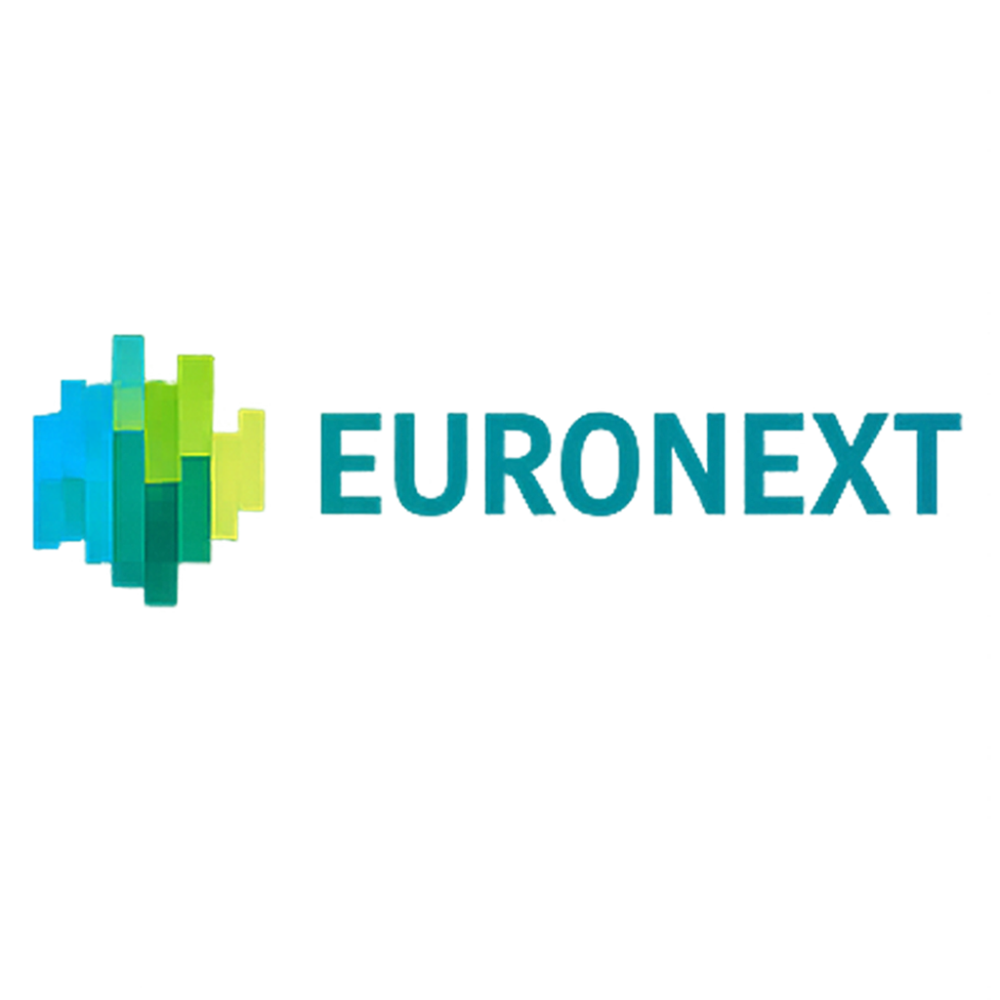

# 🌐 MACROGLIDE Globe

[English](#english) · [Українська](#українська)

**[▶ Live demo](https://fotinia-sadovskaya.github.io/macroglide-globe/)** · Status: prototype

[](./screenshots/globe.png)

---

## English

An interactive 3D globe in the browser that shows the world's major stock exchanges. Each exchange is a marker on the globe; click it to open a card with the exchange's logo, a short description and prices.

**Frontend playground** built with [Vite](https://vitejs.dev/) and [react-three-fiber](https://github.com/pmndrs/react-three-fiber) for 3D in the browser.

**Goal:** to visualise global macroeconomic data in an interactive format.

> **Status: prototype.** The prices shown in the cards are demo (sample) data, not live market quotes.

### Features (implemented)

- [x] Interactive 3D Earth with a texture map
- [x] Stock exchange markers (magenta dots) placed by geographic coordinates
- [x] Info card with logo, description and prices (demo data)
- [x] Camera controls: rotate, lock the view, zoom in and out

### Tech stack (currently used)

- React 19
- react-three-fiber and drei
- Three.js (WebGL)
- Vite
- TypeScript
- ESLint
- gh-pages (deployment)

### Roadmap (planned improvements, not yet implemented)

- [ ] Live market data via an API (Axios or the Fetch API)
- [ ] Charts for economic indicators (D3.js or Chart.js)
- [ ] Search for countries and regions
- [ ] Centering the globe on a region (for example, Asia)
- [ ] Saving favourite countries
- [ ] Export data to CSV
- [ ] Animated transitions between scenes
- [ ] Dark theme
- [ ] Styling with TailwindCSS or Styled Components
- [ ] Optional: CesiumJS for a geospatial globe

### Run locally

```bash
git clone https://github.com/fotinia-sadovskaya/macroglide-globe.git
cd macroglide-globe
npm install
npm run dev
```

### Scripts

| Command | Description |
| --- | --- |
| `npm run dev` | Start the development server |
| `npm run build` | Build the project into `dist/` |
| `npm run preview` | Preview the production build locally |
| `npm run lint` | Check the code with ESLint |
| `npm run tsc` | Run the TypeScript compiler |
| `npm run deploy` | Publish `dist/` to the `gh-pages` branch |

### Deployment

The site is published with `gh-pages`: run `npm run build`, then `npm run deploy`. In the repository, **Settings → Pages** uses the **Deploy from a branch → gh-pages** source.

### Exchanges on the globe

Binance, Coinbase, NYSE, NASDAQ, London Stock Exchange (LSE), Tokyo Stock Exchange, Hong Kong Stock Exchange, Shanghai Stock Exchange, Euronext, TSX (Toronto), BSE India, ASX (Australia).

### Project structure

```plaintext
macroglide-globe/
├── public/                  # Static files served as-is
│   ├── logos/               # Exchange logos (PNG)
│   ├── models/              # 3D models (GLB, GLTF)
│   ├── earth_texture.jpeg   # Globe texture
│   └── favicon.png
├── screenshots/             # Screenshots for the README and social previews
├── src/
│   ├── assets/              # Local media (textures, icons, 3D)
│   ├── components/          # UI components and the 3D scene
│   │   ├── ExchangeMode.jsx # Exchange display mode switcher
│   │   ├── ExchangeDot.jsx  # Exchange markers on the globe
│   │   ├── ExchangeObj.tsx  # Alternative exchange representation (3D object)
│   │   └── GlobeScene.jsx   # Main scene: globe, markers, light, camera
│   ├── data/                # Static data and types
│   │   ├── Types/Exchange.ts
│   │   └── exchanges.ts     # Exchanges with coordinates and metadata
│   ├── utils/utils.js       # Coordinate conversion and data helpers
│   ├── App.jsx, App.css
│   ├── index.css
│   └── main.jsx             # React entry point
├── index.html               # Vite HTML template
├── package.json
├── tsconfig.json
├── vite.config.js
├── eslint.config.js
├── LICENSE
└── README.md
```

### License and credits

MIT. Free to use with attribution.

This project uses [NASA Earth Textures](https://blenderartists.org/t/8k-earth-texture-download-free/1193918) and other public resources: [James Hastings-Trew](https://planetpixelemporium.com/earth.html), licensed under [CC BY 4.0](https://blenderartists.org/t/8k-earth-texture-download-free/1193918).

---

## Українська

Інтерактивна 3D-візуалізація глобуса з позначенням ключових фондових бірж світу. Кожна біржа відображається маркером на глобусі; після кліку відкривається картка з логотипом, коротким описом і цінами.

**Frontend playground**, побудований на [Vite](https://vitejs.dev/) та [react-three-fiber](https://github.com/pmndrs/react-three-fiber) для 3D-візуалізацій у браузері.

**Мета:** візуалізація глобальних макроекономічних показників в інтерактивному форматі.

> **Статус: прототип.** Ціни в картках є демонстраційними (тестовими) даними, а не реальними біржовими котируваннями.

### 🧠 Функціонал (реалізовано)

- [x] 🌍 Інтерактивний 3D-глобус із текстурою Землі
- [x] 📍 Маркери бірж (магентові точки) за географічними координатами
- [x] 🏢 Інформаційна картка з логотипом, описом і цінами (демо-дані)
- [x] 🎮 Керування камерою: обертання, фіксація, наближення та віддалення

### 🚀🛠️ Технології (використано зараз)

- React 19
- react-three-fiber та drei
- Three.js (WebGL)
- Vite
- TypeScript
- ESLint
- gh-pages (публікація)

### 📌 План розвитку (заплановано, ще не реалізовано)

- [ ] Дані бірж у реальному часі через API (Axios або Fetch API)
- [ ] Графіки економічних показників (D3.js або Chart.js)
- [ ] Пошук країн та регіонів
- [ ] Центрування на регіон (наприклад, Азія)
- [ ] Збереження обраних країн
- [ ] Експорт даних у CSV
- [ ] Анімації переходів між сценами
- [ ] Темна тема
- [ ] Стилізація через TailwindCSS або Styled Components
- [ ] Опціонально: CesiumJS для геопросторового глобуса

### 📦 Встановлення

```bash
git clone https://github.com/fotinia-sadovskaya/macroglide-globe.git
cd macroglide-globe
npm install
npm run dev
```

### Команди

| Команда | Опис |
| --- | --- |
| `npm run dev` | Запуск сервера розробки |
| `npm run build` | Збірка проєкту в папку `dist/` |
| `npm run preview` | Локальний перегляд зібраної версії |
| `npm run lint` | Перевірка коду через ESLint |
| `npm run tsc` | Запуск компілятора TypeScript |
| `npm run deploy` | Публікація `dist/` у гілку `gh-pages` |

### Розгортання

Сайт публікується через `gh-pages`: виконайте `npm run build`, потім `npm run deploy`. У налаштуваннях репозиторію **Settings → Pages** джерелом вказано **Deploy from a branch → gh-pages**.

### 📁 Структура

```plaintext
macroglide-globe/
├── public/                          # Статичні файли, доступні напряму з браузера
│   ├── logos/                       # Логотипи бірж (PNG)
│   ├── models/                      # 3D-моделі (GLB, GLTF)
│   ├── earth_texture.jpeg           # Текстура глобуса
│   └── favicon.png                  # Іконка сайту
│
├── screenshots/                     # Знімки екрана для README та соцмереж
│
├── src/                             # Вихідний код додатку
│   ├── assets/                      # Локальні медіа-файли (текстури, іконки, 3D)
│   ├── components/                  # UI-компоненти та логіка сцени
│   │   ├── ExchangeMode.jsx         # Перемикання режимів відображення бірж
│   │   ├── ExchangeDot.jsx          # Візуалізація точок бірж на глобусі
│   │   ├── ExchangeObj.tsx          # Альтернативне представлення біржі (3D-об'єкт)
│   │   └── GlobeScene.jsx           # Основна сцена: глобус, точки, світло, камера
│   ├── data/                        # Статичні дані та типи
│   │   ├── Types/Exchange.ts        # Типи TypeScript для бірж
│   │   └── exchanges.ts             # Біржі з координатами та метаданими
│   ├── utils/utils.js               # Конвертація координат, обробка даних
│   ├── App.jsx, App.css
│   ├── index.css
│   └── main.jsx                     # Точка входу в React-додаток
│
├── index.html                       # HTML-шаблон для Vite
├── package.json
├── tsconfig.json
├── vite.config.js
├── eslint.config.js
├── LICENSE
└── README.md
```

### 🌍 Світові біржі

| Біржа | Логотип | Країна |
| --- | --- | --- |
| Binance |  | 🌐 Глобальна |
| Coinbase |  | 🇺🇸 США |
| NYSE |  | 🇺🇸 США |
| NASDAQ |  | 🇺🇸 США |
| LSE |  | 🇬🇧 Велика Британія |
| Tokyo SE |  | 🇯🇵 Японія |
| Hong Kong SE |  | 🇭🇰 Гонконг |
| Shanghai SE |  | 🇨🇳 Китай |
| Euronext |  | 🇪🇺 Європа |
| TSX |  | 🇨🇦 Канада |
| BSE India |  | 🇮🇳 Індія |
| ASX |  | 🇦🇺 Австралія |

### Приклад картки: Shanghai Stock Exchange (демо-дані)

> **Shanghai SE** — найбільша біржа материкового Китаю, що відіграє ключову роль у розвитку економіки країни.

- 🔹 Остання ціна: `27420`
- 🟢 Купівля: `27370`
- 🔴 Продаж: `27420`

### 📑 Ліцензія та авторські права

MIT — вільне використання із зазначенням авторства.

Проєкт використовує [NASA Earth Textures](https://blenderartists.org/t/8k-earth-texture-download-free/1193918) та інші публічні ресурси — [James Hastings-Trew](https://planetpixelemporium.com/earth.html), згідно з ліцензією [CC BY 4.0](https://blenderartists.org/t/8k-earth-texture-download-free/1193918).

---

## 🌐 Онлайн-версія / Live demo

[MACROGLIDE Globe](https://fotinia-sadovskaya.github.io/macroglide-globe/)

